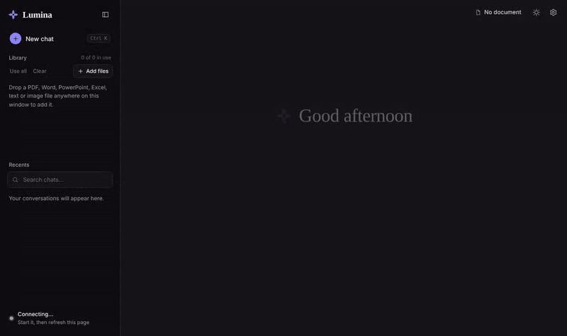
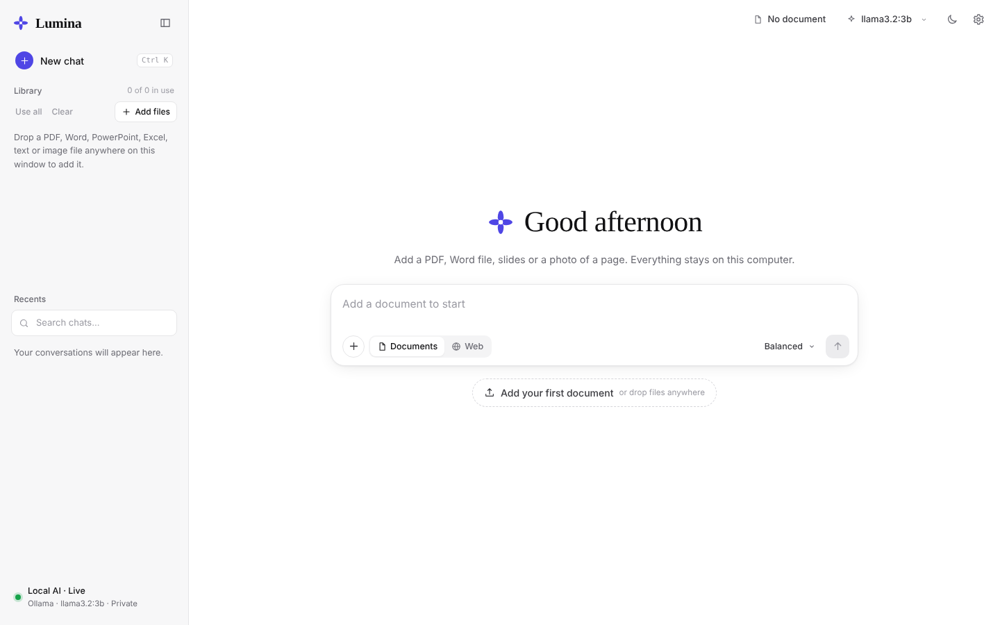
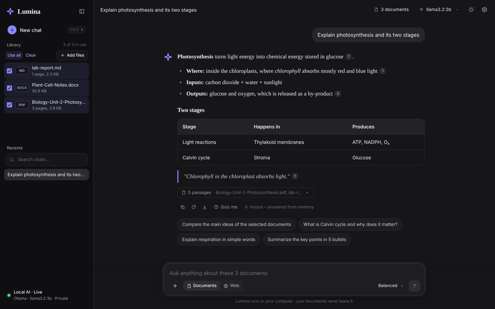
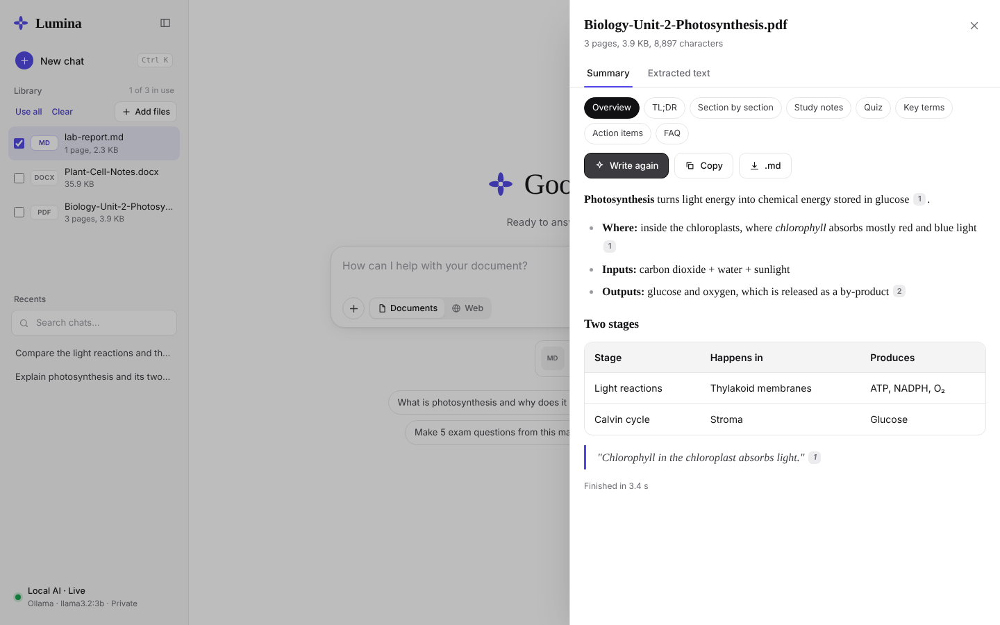
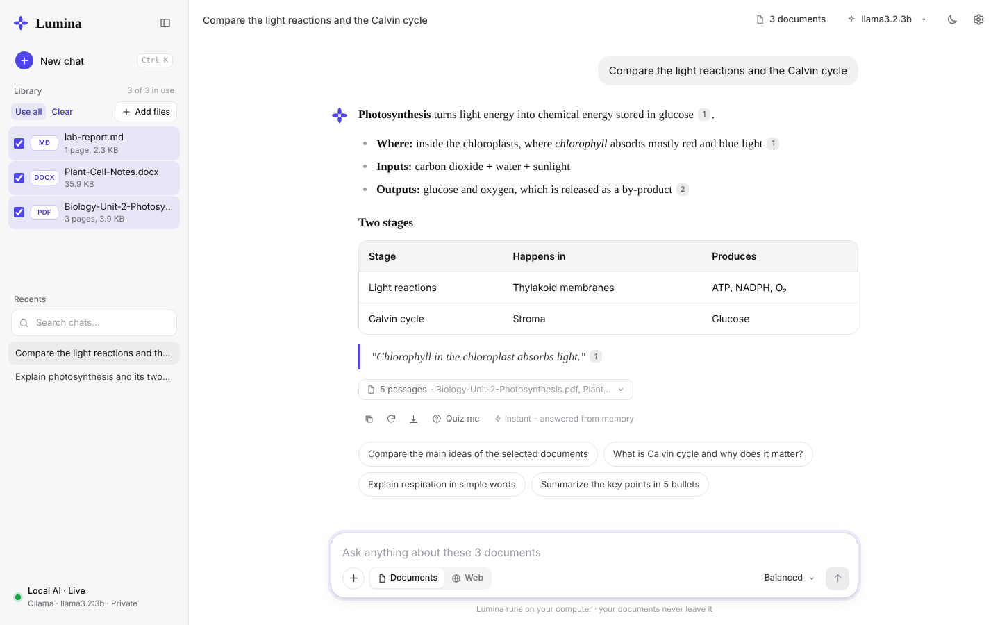
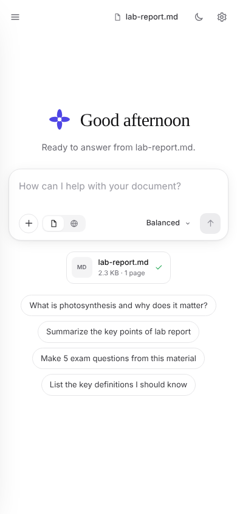

<div align="center">


# Lumina

### Chat with your documents — privately, on your own computer.

Upload PDFs, Word files, slide decks, spreadsheets, code or photos of pages. Ask questions and get **streaming answers with the exact passages they came from**, or generate summaries, study notes, quizzes and glossaries. Everything runs locally through [Ollama](https://ollama.com) (or any OpenAI-compatible local server). **No cloud account, no API key, no document ever leaves your machine.**




</div>

---

## Table of contents

- [Features](#features)
- [Screenshots](#screenshots)
- [How it works](#how-it-works)
- [Tech stack and libraries](#tech-stack-and-libraries)
- [Requirements](#requirements)
- [Installation (step by step)](#installation-step-by-step)
- [Running the app](#running-the-app)
- [How to use it](#how-to-use-it)
- [Configuration](#configuration)
- [Use LM Studio, llama.cpp or another server instead of Ollama](#use-lm-studio-llamacpp-or-another-server-instead-of-ollama)
- [API overview](#api-overview)
- [Project structure](#project-structure)
- [Privacy and security](#privacy-and-security)
- [Troubleshooting](#troubleshooting)
- [Development and tests](#development-and-tests)
- [Contributing](#contributing)
- [License](#license)

---

## Features

**Ask and understand**
- 💬 **Chat with one or many documents at once** – tick files in the library; every answer cites numbered passages. Click a citation to see the highlighted source text.
- ⚡ **Streaming answers** – words appear as they are generated, with a Stop button and timing after each answer.
- 🎛️ **8 answer styles** – Balanced, Concise, Detailed, Bullet points, Explain simply, Study notes, Table / compare, With exact quotes.
- 🌍 **Answer in 14 languages** – English, Hindi, Tamil, Telugu, Kannada, Malayalam, Marathi, Bengali, Spanish, French, German, Arabic, Chinese, Japanese – even when the document is in another language.
- 🧠 **Follow-up questions** – the chat remembers recent messages, so "why?" or "explain more" just works.
- ✨ **Instant suggested questions** built from the key terms of the documents you select (no waiting for the AI).
- 📚 **"Summarize this" works on the whole file** – questions like *"give a summary of this ppt"* or *"key points"* use excerpts from the beginning to the end of the document, not just a few matching passages.

**Summaries and study tools**
- 📝 Overview, TL;DR, Section by section, Study notes, **Quiz**, **Key terms glossary**, **Action items** and **FAQ** – streamed, covering the *whole* document, downloadable as Markdown.

**Files**
- 📄 PDF, DOCX, PPTX, XLSX, XLS, CSV, TXT, MD, RST, JSON, XML, YAML, TOML, INI, HTML, LOG, TEX
- 👩‍💻 Source code: `.py .js .ts .jsx .tsx .java .c .cpp .cs .go .rs .php .rb .sql .sh .css`
- 🖼️ Images and scanned PDFs (PNG, JPG, BMP, TIFF, WEBP) via OCR

**Speed**
- ⏱️ **Files are ready in seconds** – you can ask questions as soon as the text is read. Meaning-based "smart search" is added in the background, one file at a time, and pauses while an answer is being written.
- ⏱️ **Complete answers, first words sooner** – answers always keep their full length. Lumina measures how fast your computer runs the model and, on a slow CPU, gives it only the sentences that matter for your question (instead of whole passages), so it starts writing much sooner. A countdown shows when the first words will appear, and a tip offers a faster model when your PC is slow.
- 🚦 **Your question always goes first** – only one request reaches the AI model at a time, questions jump ahead of background work, and time spent waiting in the queue never causes a timeout.
- 🚀 **Instant answers for repeated questions** (in-memory answer cache)
- Model pre-loaded at start-up, pooled connections, in-RAM search indexes, the question is embedded *while* indexes load, parallel OCR – see [Why it is fast](docs/architecture.md#why-it-is-fast).

**Interface**
- 🎨 **Clean chat interface** – white and black with one indigo accent, a centred conversation, serif answers that flow onto the screen smoothly (new paragraphs fade in), an animated Lumina mark while it thinks, collapsible sidebar, light and dark themes, and an *Animations* switch in ⚙ Settings.
- 🌗 Dark and light themes, drag-and-drop upload with progress, chat history (rename, search, export to Markdown), keyboard shortcuts, works on phones.

**Flexible engine**
- 🦙 Ollama by default, **or** LM Studio / llama.cpp / vLLM / Jan / LocalAI through the OpenAI-compatible API.
- 🎨 Optional **Image mode** – describe a picture and Lumina paints it **on your computer** with Stable Diffusion (SD-Turbo, works on Windows CPUs), or with any OpenAI-compatible image server such as Ollama's image models on macOS. Images can be downloaded as PNG.
- 🌐 Optional **Web mode** – researches public sources (GitHub, Stack Overflow, arXiv, Hugging Face, DuckDuckGo, optional Google) and writes a cited answer.

## Screenshots

| Welcome | Answer with sources |
|---|---|
|  |  |
| **Summaries & study tools** | **Light theme** |
|  |  |

<p align="center"></p>

## How it works

```text
 Browser  (React + Vite, port 5173)
    │  /api/*   (Vite proxies to the backend)
    ▼
 FastAPI backend  (port 5001) ───────────────► SQLite  storage/app.db
    │                                          documents, chunks, chats
    │  1. extract text  (PDF / Office / OCR …)
    │  2. split into chunks
    │  3. embed chunks ──► storage/rag/<id>.npy  (vector index, cached in RAM)
    ▼
 Ollama  (port 11434)            – or LM Studio / llama.cpp / vLLM
   • chat model       e.g. llama3.2:3b
   • embedding model  e.g. embeddinggemma
```

When you ask a question, Lumina finds the most relevant passages with **hybrid search** (80 % meaning-based vector similarity + 20 % keyword BM25), sends only those passages to the local model and streams the answer back. This is called **RAG – Retrieval-Augmented Generation**. More detail: [docs/architecture.md](docs/architecture.md).

## Tech stack and libraries

| Layer | Library | What it is used for |
|---|---|---|
| **Frontend** | [React 19](https://react.dev) | user interface |
| | [Vite 7](https://vite.dev) | dev server, production build, `/api` proxy |
| | [Fontsource](https://fontsource.org) (Inter, Source Serif 4, JetBrains Mono) | fonts bundled locally – no Google Fonts request |
| | CSS animations | animated background, buttons and messages (no animation library) |
| **Backend** | [FastAPI](https://fastapi.tiangolo.com) + [Uvicorn](https://www.uvicorn.org) | REST API and streaming (Server-Sent Events) |
| | [SQLAlchemy 2](https://www.sqlalchemy.org) + SQLite | documents, chunks and chats |
| | [pydantic-settings](https://docs.pydantic.dev/latest/concepts/pydantic_settings/) | configuration from `.env` |
| | [httpx](https://www.python-httpx.org) | async calls to Ollama / LLM server and web search |
| | [NumPy](https://numpy.org) | vector search (one matrix multiplication) |
| | [python-multipart](https://github.com/Kludex/python-multipart) | file uploads |
| **Extraction** | [PyMuPDF](https://pymupdf.readthedocs.io) | PDF text and page rendering (falls back to pypdfium2 / pypdf if not installed) |
| | [python-docx](https://python-docx.readthedocs.io), [python-pptx](https://python-pptx.readthedocs.io) | Word and PowerPoint |
| | [openpyxl](https://openpyxl.readthedocs.io), [xlrd](https://xlrd.readthedocs.io) | Excel `.xlsx` / `.xls` |
| | [Beautiful Soup 4](https://www.crummy.com/software/BeautifulSoup/) | HTML |
| | [pytesseract](https://github.com/madmaze/pytesseract) + [Pillow](https://python-pillow.org) + [Tesseract OCR](https://github.com/tesseract-ocr/tesseract) | reading scanned pages and images |
| **AI** | [Ollama](https://ollama.com) | runs the chat model and the embedding model locally |
| **Dev** | pytest, ruff, pip-audit, ESLint, GitHub Actions | tests, linting, security audit, CI |

## Requirements

| Tool | Version | Download |
|---|---|---|
| **Python** | 3.10 or newer (3.12 recommended) | https://www.python.org/downloads/ – on Windows tick **"Add python.exe to PATH"** |
| **Node.js** | 20 or newer (includes npm) | https://nodejs.org (LTS) |
| **Ollama** | latest | https://ollama.com/download |
| **Git** | any | https://git-scm.com/downloads |
| Tesseract OCR *(optional)* | 5.x – only for scanned PDFs / images | Windows: [UB-Mannheim installer](https://github.com/UB-Mannheim/tesseract/wiki) · macOS: `brew install tesseract` · Ubuntu/Debian: `sudo apt install tesseract-ocr` |

**Hardware:** 8 GB RAM is enough for `llama3.2:3b` (about 2 GB). A GPU makes answers much faster but is not required. Disk: ~3 GB for the models.

Check your tools:

```bash
python --version      # macOS/Linux: python3 --version
node --version
npm --version
ollama --version
git --version
```

## Installation (step by step)

> Replace `<your-username>` with your GitHub user name. If you renamed the repository, use that name instead of `lumina`.

### Option A – automatic setup scripts (easiest)

**Windows (PowerShell):**

```powershell
git clone https://github.com/<your-username>/lumina.git
cd lumina
powershell -ExecutionPolicy Bypass -File scripts\setup.ps1
powershell -ExecutionPolicy Bypass -File scripts\start.ps1
```

**macOS / Linux:**

```bash
git clone https://github.com/<your-username>/lumina.git
cd lumina
bash scripts/setup.sh
bash scripts/start.sh
```

The setup script creates the Python virtual environment, installs all Python and npm packages, creates your `.env` and downloads the two AI models. The start script launches the backend and frontend; open **http://127.0.0.1:5173**.

### Option B – manual setup (any OS)

**1. Clone the project**

```bash
git clone https://github.com/<your-username>/lumina.git
cd lumina
```

**2. Download the AI models** (once – Ollama must be installed and running)

```bash
ollama pull llama3.2:3b        # chat model (~2 GB)
ollama pull embeddinggemma     # embedding model for semantic search (~600 MB)
```

> Low on RAM? Use `llama3.2:1b` or `qwen2.5:1.5b`. Have a strong GPU? Try `qwen2.5:7b` or `llama3.1:8b`. Set the name in `.env` → `OLLAMA_MODEL`.

**3. Backend – Python virtual environment and packages**

Windows (PowerShell):

```powershell
python -m venv .venv
.\.venv\Scripts\Activate.ps1
python -m pip install --upgrade pip
python -m pip install -r backend\requirements.txt
Copy-Item .env.example .env
```

macOS / Linux:

```bash
python3 -m venv .venv
source .venv/bin/activate
python -m pip install --upgrade pip
python -m pip install -r backend/requirements.txt
cp .env.example .env
```

> **Windows + OCR:** after installing Tesseract, open `.env` and set
> `TESSERACT_CMD=C:\Program Files\Tesseract-OCR\tesseract.exe`

**4. Frontend – npm packages**

```bash
cd frontend
npm install
cd ..
```

### Option C – Docker

```bash
docker compose up --build
docker compose exec ollama ollama pull llama3.2:3b
docker compose exec ollama ollama pull embeddinggemma
```

Then open http://localhost:5173.

## Running the app

You need **two terminals** (the start scripts above do this for you).

**Terminal 1 – backend** (from the project folder, with the virtual environment activated):

```bash
python -m uvicorn backend.app.main:app --port 5001
```

> Changing the Python code yourself? Add `--reload --reload-dir backend` so the server restarts on code changes. Don't use plain `--reload`: it also watches `frontend/node_modules` and restarts in the middle of processing your files.

**Terminal 2 – frontend:**

```bash
cd frontend
npm run dev
```

Open **http://127.0.0.1:5173** in your browser. Interactive API docs: http://127.0.0.1:5001/docs

### One-port mode (no Node needed after building)

```bash
cd frontend && npm run build && cd ..
python -m uvicorn backend.app.main:app --port 5001
```

The backend now also serves the interface at **http://127.0.0.1:5001**.

### Share it on the internet (Cloudflare Tunnel)

1. Set a password in `.env` – Lumina then shows a lock screen to every visitor:
   ```
   ACCESS_PASSWORD=choose-a-long-password
   ```
2. Build the interface and start the backend in one-port mode (above).
3. In a second terminal (install once with `winget install --id Cloudflare.cloudflared`):
   ```powershell
   cloudflared tunnel --url http://localhost:5001
   ```
4. Share the `https://….trycloudflare.com` link it prints, plus the password.

The link works only while your PC, Ollama, the backend and the tunnel are running. Stop sharing with **Ctrl + C**.

## Image generation (optional)

Click **Image** in the message box, describe a picture and press Enter. Images are made on your computer and saved in `storage/images/`.

**1. Install the extra libraries** (only once; PyTorch and the model are a few GB):
```powershell
.\.venv\Scripts\Activate.ps1
pip install torch --index-url https://download.pytorch.org/whl/cpu
pip install -r backend\requirements-image.txt
```
Have an NVIDIA graphics card? Install the CUDA build of PyTorch from [pytorch.org](https://pytorch.org/get-started/locally/) instead of the first line – images become much faster.

**2. Restart the backend.** The first start downloads the model (`stabilityai/sd-turbo` plus a tiny fast decoder, about 2–3 GB, internet needed once). Lumina then **loads the model in the background at start-up**, so it is ready before you ask. After that every image is made offline.

**Making it faster on a slow PC**
- `IMAGE_SIZE=256` – about 2× faster than the default 384 (512 gives the best detail but is slowest).
- `IMAGE_FAST_DECODER=true` (default) – uses the tiny TAESD decoder, which is much faster on a CPU.
- Close other heavy programs; an NVIDIA GPU with the CUDA build of PyTorch is by far the biggest speed-up.

**Don't want images at all?** Put `IMAGE_PROVIDER=off` in `.env` and restart – the Image button disappears and nothing is loaded. You can also uninstall the extra libraries: `pip uninstall torch diffusers transformers accelerate`.

**Settings** (in `.env`):

| Setting | Default | Meaning |
|---|---|---|
| `IMAGE_PROVIDER` | `local` | `local` = Stable Diffusion on this PC · `openai` = an OpenAI-compatible image server · `off` = Image button removed |
| `IMAGE_MODEL` | `stabilityai/sd-turbo` | Any Hugging Face text-to-image model that `diffusers` can load |
| `IMAGE_SIZE` / `IMAGE_STEPS` | `384` / `1` | Image size in pixels (256–1024) and drawing steps (SD-Turbo needs only 1) |
| `IMAGE_FAST_DECODER` / `IMAGE_PRELOAD` | `true` / `true` | Tiny fast decoder · load the model in the background at start-up |
| `IMAGE_API_BASE_URL` / `IMAGE_API_MODEL` | Ollama / `x/z-image-turbo` | Used only with `IMAGE_PROVIDER=openai` |

SD-Turbo is released by Stability AI under its own licence – free for personal and research use; read [stability.ai/license](https://stability.ai/license) before using images commercially.

## How to use it

1. **Add files** – drag them onto the window or click *Add files*. A progress bar shows each step (reading text → splitting → building the search index).
2. **Choose documents** – tick one or more files in the Library (or *Use all*).
3. **Ask** – type a question and press **Enter**, or click a suggested question. Pick an answer style next to the input.
4. **Check the sources** – click a numbered chip under an answer to see the highlighted passage.
5. **Summaries & study tools** – click the eye icon on a file (or *Summary*), choose Overview, TL;DR, Study notes, Quiz, Key terms, Action items or FAQ, then *Write summary*.
6. **Settings (⚙)** – answer language, default style, background animation on/off, light/dark theme.
7. **Web mode** – switch the input to *Web* to research public sources.

| Shortcut | Action |
|---|---|
| `Enter` / `Shift+Enter` | send / new line |
| `Ctrl+K` (`⌘K` on Mac) | new chat |
| `/` | jump to the question box |
| `Esc` | close the summary drawer |

## Configuration

All settings live in `.env` (copied from [`.env.example`](.env.example), which documents every option). The most useful ones:

| Setting | Default | What it does |
|---|---|---|
| `LLM_PROVIDER` | `ollama` | `ollama` or `openai` (any OpenAI-compatible server) |
| `OLLAMA_MODEL` | `llama3.2:3b` | default chat model (any model from `ollama list`) |
| `RAG_EMBEDDING_MODEL` | `embeddinggemma` | embedding model; `nomic-embed-text` also works |
| `LLM_NUM_CTX` | `4096` | context window – lower is faster on CPU |
| `LLM_TIMEOUT` | `600` | seconds the model may take once it starts on your request |
| `LLM_MAX_PARALLEL` | `1` | requests sent to the model at once (keep 1 on CPU) |
| `RAG_TOP_K` / `RAG_MAX_CONTEXT_CHARS` | `5` / `5000` | how much document text each answer uses – smaller = faster first word |
| `LLM_SUGGESTIONS` | `false` | `true` lets the AI write the suggested questions (slow on CPU) |
| `CHUNK_SIZE` / `CHUNK_OVERLAP` | `1400` / `200` | passage size for search |
| `LLM_KEEP_ALIVE` | `2h` | how long the model stays loaded in memory (reloading costs time) |
| `ADAPTIVE_SPEED` / `READ_TARGET_SECONDS` | `true` / `15` | on a slow PC, give the model focused passages so the first words appear in about 15 s (answers keep their full length) |
| `SUMMARY_READ_TARGET_SECONDS` | `30` | the same for summaries |
| `ANSWER_HARD_LIMIT_SECONDS` | `0` | optional: stop writing after N seconds; `0` = never (answers are always complete) |
| `ANSWER_CACHE_ENABLED` | `true` | instant answers for repeated questions |
| `TESSERACT_CMD` | empty | path to `tesseract.exe` on Windows |
| `WEB_RESEARCH_ENABLED` | `true` | turn Web mode on or off |
| `GOOGLE_API_KEY`, `GOOGLE_CSE_ID` | empty | optional Google Programmable Search |
| `MAX_FILE_SIZE_MB` | `25` | upload size limit |

After changing the chunk size or embedding model, rebuild the search index:

```bash
python scripts/reindex_all_rag.py
```

## Use LM Studio, llama.cpp or another server instead of Ollama

Any server that speaks the OpenAI API works. In `.env`:

```env
LLM_PROVIDER=openai
OPENAI_BASE_URL=http://127.0.0.1:1234/v1      # LM Studio   (llama.cpp: http://127.0.0.1:8080/v1)
OPENAI_MODEL=qwen2.5-7b-instruct              # the model name shown by your server
OPENAI_EMBEDDING_MODEL=text-embedding-nomic-embed-text-v1.5   # optional; empty = keyword search
OPENAI_API_KEY=                               # empty for local servers
```

> ⚠️ If you point this at a hosted API, the passages sent with each question leave your computer. Keep any real key **only in `.env`** – never in code.

## API overview

Interactive docs at http://127.0.0.1:5001/docs.

| Method | Endpoint | Purpose |
|---|---|---|
| GET | `/api/health` | backend, LLM and cache status |
| GET | `/api/config` | answer styles, summary types, languages |
| GET | `/api/models` | installed chat models |
| POST | `/api/documents/upload` | upload a file |
| GET | `/api/documents` | list documents with status and progress |
| GET | `/api/documents/{id}/preview` | extracted text |
| POST | `/api/documents/{id}/summary/stream` | stream a summary (`summary_type`, `language`) |
| GET | `/api/documents/{id}/summary/download?format=md` | download the summary |
| DELETE | `/api/documents/{id}` | delete file, index and related chats |
| POST | `/api/multi-document/ask/stream` | stream an answer from several documents |
| POST | `/api/suggestions` | suggested questions for the selected documents |
| POST | `/api/chats` | create a chat (`document_ids`) |
| POST | `/api/chats/{id}/messages/stream` | ask in a chat (`question`, `style`, `language`, `model`, `regenerate`) |
| GET | `/api/chats/{id}/export` | export a chat as Markdown |
| POST | `/api/research/stream` | web research answer |

## Project structure

```text
lumina/
├── backend/
│   ├── app/
│   │   ├── main.py              # API routes, streaming, one-port mode
│   │   ├── core/                # settings (.env), upload safety
│   │   ├── db/                  # SQLite engine and light migrations
│   │   ├── models/              # Document, DocumentChunk, ChatSession, ChatMessage
│   │   └── services/
│   │       ├── extraction/      # PDF, Office, spreadsheet, text/code, image (OCR)
│   │       ├── llm.py           # Ollama + OpenAI-compatible client, prompts, styles, languages
│   │       ├── rag_service.py   # embeddings, hybrid search, caching
│   │       ├── answer_cache.py  # instant answers for repeated questions
│   │       ├── suggest.py       # instant suggested questions (key terms)
│   │       ├── summary.py       # streaming summaries, quiz, glossary, FAQ
│   │       ├── chat.py          # chat sessions and history
│   │       └── web_research.py  # public web research
│   ├── tests/                   # pytest suite with a fake Ollama
│   ├── requirements.txt
│   └── requirements-dev.txt
├── frontend/
│   ├── src/
│   │   ├── App.jsx              # app state, streaming, settings
│   │   ├── api.js               # fetch, upload progress, SSE reader
│   │   ├── components/          # Backdrop (animation), Sidebar, Message, Composer, DocDrawer…
│   │   └── styles.css           # white/black + indigo theme, light + dark
│   ├── public/favicon.svg
│   ├── index.html
│   ├── package.json
│   └── vite.config.js
├── scripts/                     # setup, start, reindex, cleanup, secret scan
├── docs/                        # architecture, development, security, screenshots
├── storage/                     # YOUR data – git-ignored, never committed
├── .env.example                 # copy to .env (git-ignored)
├── Dockerfile
└── docker-compose.yml
```

## Privacy and security

- Files, extracted text, search indexes and chats are stored in `storage/` on your computer, and the AI model runs locally. `storage/` and `.env` are in `.gitignore`, so **your documents and keys are never pushed to GitHub**.
- Only **Web mode** contacts the internet, and it sends your question – not your files. Turn it off with `WEB_RESEARCH_ENABLED=false`.
- Fonts are bundled with the app, so the interface makes no requests to Google or other CDNs.
- Run `python scripts/secret_scan.py` before every push – it fails if it finds an API key in the code.
- Built for **one trusted local user**. Add authentication before exposing it on a network.

Details: [docs/security.md](docs/security.md).

## Troubleshooting

| Problem | Fix |
|---|---|
| "Ollama is not reachable" in the sidebar | Start Ollama (open the Ollama app, or run `ollama serve`) and check `ollama list`. |
| "Backend is not running" | Start terminal 1: `python -m uvicorn backend.app.main:app --port 5001` |
| `'vite' is not recognized` | Run `npm install` inside the `frontend` folder first. |
| Backend keeps restarting ("WatchFiles detected changes") | Start it without `--reload`, or with `--reload --reload-dir backend`. |
| Library shows "smart search…" for a while | Normal: the file is already usable (keyword search). Meaning-based search is added in the background, one file at a time, and pauses while you get answers. On a slow PC set `RAG_EMBEDDING_MODEL=nomic-embed-text` (run `ollama pull nomic-embed-text`). |
| `model "llama3.2:3b" not found` | `ollama pull llama3.2:3b`, or set `OLLAMA_MODEL` to a model you have. |
| Sources still say "keyword" long after upload | `ollama pull embeddinggemma`, then `python scripts/reindex_all_rag.py`. |
| Scanned PDF shows no text / log says "Tesseract not found" | Install Tesseract and set `TESSERACT_CMD=C:\Program Files\Tesseract-OCR\tesseract.exe` in `.env` (Windows). Normal PDFs work without it. |
| `Activate.ps1 cannot be loaded` (Windows) | Run once: `Set-ExecutionPolicy -Scope CurrentUser RemoteSigned` |
| `pip install` fails on PyMuPDF (very new Python) | Use Python 3.12, or run `pip install pypdfium2` – Lumina falls back to it automatically. |
| Frontend shows network errors | The backend must run on port 5001. Different port? `BACKEND_URL=http://127.0.0.1:<port> npm run dev` |
| A full answer takes a long time | Writing speed depends on your processor and the model size. Lumina already starts writing sooner by reading only the relevant sentences. For 2–3× faster writing use a smaller model: `ollama pull llama3.2:1b` (or `qwen2.5:1.5b`), then pick it in the model menu at the top. |
| Answers are slow | On a CPU-only laptop pick a smaller model in ⚙ Settings: `ollama pull llama3.2:1b` or `ollama pull qwen2.5:1.5b` (2–3× faster than 3B). Use the *Concise* style, set `RAG_MAX_CONTEXT_CHARS=3500` and `LLM_NUM_CTX=3072`, and close other heavy apps. |
| "The AI model did not answer within … seconds" / "Local Ollama streaming request failed" | Your PC was busy. Update to v6.1 (questions are queued so waiting no longer times out), use a smaller model, or raise `LLM_TIMEOUT` in `.env`. Check the model works with `ollama run llama3.2:3b "hi"`. |
| `ModuleNotFoundError` | Activate the virtual environment and run `pip install -r backend/requirements.txt` again. |

## Development and tests

```bash
pip install -r backend/requirements-dev.txt
pytest backend/tests -q                                  # fake Ollama – no model needed, ~2 s
ruff check backend --select E,F,W,B --ignore E501,B008   # lint
python scripts/secret_scan.py                            # before every push

cd frontend
npm run lint
npm run build
```

**How well does it work on your PC?** With the backend and Ollama running:

```bash
python scripts/evaluate.py --quick     # 6 core tests, ~5-10 min on a CPU
python scripts/evaluate.py             # all 15 tests
```

It asks real questions about a test document with known answers and scores accuracy, honesty (does it admit when something is not in the document?), whole-document summaries, follow-up memory, every answer style, completeness, citations and speed, then writes `evaluation-results.md`. The full list of automated, effectiveness and manual test cases is in [docs/TEST_CASES.md](docs/TEST_CASES.md).

More: [docs/development.md](docs/development.md).

## Contributing

Issues and pull requests are welcome! Please read [CONTRIBUTING.md](CONTRIBUTING.md), run the tests and `python scripts/secret_scan.py` before opening a pull request.

## License

[MIT](LICENSE) – free to use, modify and share.
